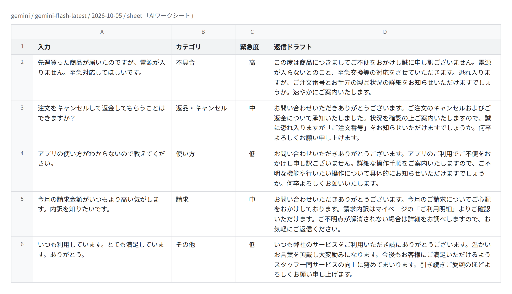

# sheet-ai-batch

[](https://github.com/Mxhlix/sheet-ai-batch/actions/workflows/test.yml)

English | [日本語](#日本語)

A Google Apps Script that sends each row of a Google Sheets spreadsheet to a generative AI (Gemini or Claude) and writes the result into the columns next to it.
Changing the prompt and the output columns switches the job, for example classifying, summarizing, translating or drafting replies.



The image shows the five demo inquiries after `Code.gs` sent them to the real Gemini API (`gemini-flash-latest`) on 2026-10-05. The category, urgency and reply columns are Gemini's actual answers. The sheet itself is imitated on Node, so the table is drawn from the result file [docs/live-run.json](docs/live-run.json). It is not a capture of Google Sheets.

## What it does

- Reads the 「入力」 (input) column of the sheet row by row, sends each text to a generative AI, and writes the result to the output columns.
- The default setup triages support inquiries. It fills 「カテゴリ」 (category), 「緊急度」 (urgency) and 「返信ドラフト」 (draft reply).
- The task is set by `TASK_PROMPT` and `OUTPUT_FIELDS`. If an input or output column is missing, it adds the header.
- The provider is chosen with `CONFIG.AI.PROVIDER`: `gemini` (default) or `claude`.
- Can be run from the sheet menu 「AIワークシート > AIで一括処理」, or on a schedule (every N hours, or once a day at a set hour).
- A demo mode fills in five sample inquiries and answers them with simple keyword rules, without an API key and without network access.

## Design notes

- The output shape is fixed with structured output. The JSON schema is built in one place (`buildSchema_`) from `OUTPUT_FIELDS`, and only converted into each provider's format. Adding a column updates the schema for both providers.
- The API key is not in the code. `CONFIG.AI.API_KEY` is empty by default, and the key is read from the script property `AI_API_KEY`. The property name stays the same when you switch providers.
- The Gemini key is sent in the `x-goog-api-key` header, not in the URL, because URLs tend to end up in logs.
- Rows whose output columns are all filled are skipped. Running it again continues from where it stopped and does not send finished rows again.
- `MAX_ROWS_PER_RUN` (default 20) limits how many rows one run sends, to keep cost and rate limits in check. The rest are handled on the next run.
- If a row fails (no key, API error, unreadable response), it is logged and left blank, so the next run tries it again.
- `createTriggers` rebuilds only the triggers for `processSheet` and leaves other triggers alone. It throws an error on an invalid interval or hour instead of creating a trigger.
- The permissions are limited to the current spreadsheet (`spreadsheets.currentonly`) and outbound requests (`script.external_request`).

## Verification

GAS does not run locally, so `test/run-tests.js` imitates the GAS features it uses (spreadsheet, `UrlFetchApp`, script properties, menu, triggers, `Logger`) and runs `src/Code.gs` on Node without modification.
`UrlFetchApp` is replaced in the tests. No real Gemini or Claude API is called. The request bodies are checked for their shape, and the responses are prepared in the test.

Main things checked:

- Defaults: the provider is `gemini` and the model name starts with `gemini-`.
- Gemini request: the key is read from `AI_API_KEY` and sent in the `x-goog-api-key` header and not in the URL. The response schema has the output columns as keys, uses the Gemini type names (`OBJECT` / `STRING`), and omits `additionalProperties`. The row text is inserted into the prompt.
- Claude request: the URL, the `x-api-key` and `anthropic-version` headers, the model and token limit from `CONFIG.AI`, and a `json_schema` output format with the output columns as keys.
- Changing the output columns changes the schema for both providers.
- With no key or an unknown provider, nothing is sent. An API error or a broken response returns nothing.
- Demo mode creates five sample rows and fills them with no requests sent.
- With `MAX_ROWS_PER_RUN` set to 2, five rows are finished over three runs.
- With demo mode off, empty rows are skipped, each row is sent once, the result is written to the output columns, and finished rows are not sent again.
- The menu calls `processSheet`. The trigger settings (every hour, every 4 hours, daily at 9) create the right trigger, and invalid values throw.

Run on 2026-10-05 with Node.js 24.12.0, all 44 checks passed.

### Run against the real Gemini API

`test/live-gemini.js` imitates only the spreadsheet. `UrlFetchApp.fetch` sends a real HTTPS request, so the request body built by `Code.gs` is what Gemini receives. It is not part of `npm test` or CI, because it needs a key.

```
GEMINI_API_KEY=... node test/live-gemini.js
```

Result on 2026-10-05 (`gemini-flash-latest`):

- Gemini accepted the request body, including the `responseSchema`, and all five rows were filled with category, urgency and a draft reply. The answers are in [docs/live-run.json](docs/live-run.json).
- It took 6 runs. Of 18 requests, 6 returned 200, 10 returned 503 (the model was busy) and 4 returned 429 (quota). Failed rows stayed blank and were filled on a later run, as designed.
- `Code.gs` itself does not retry within a run. With a scheduled trigger, the next run picks the rows up.
The test script exits with code 1 if any check fails. This was confirmed by running it against a copy of `Code.gs` with the default provider changed.

## Getting started

The tests use only Node.js built-ins, with no external packages.
Checked locally on Node.js 24.12.0. On GitHub Actions it passes on Node.js 18, 20 and 22 (2026-10-05).

```
npm test    # run Code.gs in the GAS imitation and check 44 items
```

To run it on GAS, open Extensions > Apps Script in a Google Sheets spreadsheet, add `src/Code.gs` and `src/appsscript.json`, and run the function `processSheet`.
It starts in demo mode. It creates a sheet 「AIワークシート」 with five sample inquiries and fills in the output columns.
The demo steps, connecting a real AI provider and setting up scheduled runs are in [src/README.md](src/README.md) (Japanese).

## Project layout

```
src/
  Code.gs            main logic (row loop, Gemini and Claude requests, schema, demo mode, triggers)
  appsscript.json    manifest (time zone and permissions)
  README.md          setup steps for Apps Script
test/
  run-tests.js       GAS imitation and the tests
  live-gemini.js     run against the real Gemini API (needs a key, not in CI)
docs/
  screen.png         the sheet after the real Gemini run, drawn from live-run.json
  live-run.json      inputs, outputs and HTTP status of each request in that run
.github/workflows/
  test.yml           runs npm test on Node.js 18, 20 and 22
```

## Not yet verified

- All tests in this repository are results in the GAS imitation. This repository keeps no record of running it on real Apps Script.
- The real Claude API was not called. Whether it accepts this request body (`output_config.format`) is not tested here. The Gemini side was run once, on 2026-10-05 (see above).
- The Gemini schema conversion (`geminiSchema_`) only handles string fields. All fields built by `buildSchema_` are strings today.

## License

MIT. See [LICENSE](LICENSE).

---

## 日本語

Google スプレッドシートの各行を生成AI（Gemini か Claude）に送り、結果を隣の列に書き込む Google Apps Script です。
プロンプトと出力列を変えると、分類・要約・翻訳・返信の下書きのように用途が変わります。


画像は、2026-10-05 に `Code.gs` がデモの問い合わせ5件を本物の Gemini API（`gemini-flash-latest`）に送ったあとの結果です。カテゴリ・緊急度・返信ドラフトの列は、Gemini が実際に返した答えです。シートは Node の上で模擬しているので、結果のファイル [docs/live-run.json](docs/live-run.json) から表を描きました。Google スプレッドシートの画面ではありません。

### できること

- シートの「入力」列を1行ずつ読み、生成AIに送って、結果を出力列に書き込みます。
- 既定の設定は問い合わせの振り分けです。「カテゴリ」「緊急度」「返信ドラフト」を埋めます。
- 処理の中身は `TASK_PROMPT` と `OUTPUT_FIELDS` で決めます。入力列や出力列が無ければ見出しを足します。
- 使う生成AIは `CONFIG.AI.PROVIDER` で選びます。`gemini`（既定）か `claude` です。
- シートのメニュー「AIワークシート > AIで一括処理」から実行できます。決まった間隔（N時間ごと、または毎日決まった時台）で自動実行もできます。
- デモモードでは、サンプルの問い合わせ5件を入れ、簡単なキーワードの規則で答えを埋めます。APIキーも通信も使いません。

### 設計で気をつけたこと

- **出力の形は構造化出力で決める。** JSON のスキーマは `buildSchema_` の1か所で `OUTPUT_FIELDS` から作り、提供元ごとの形式に変換するだけです。列を足せば両方の提供元のスキーマが変わります。
- **APIキーをコードに書かない。** `CONFIG.AI.API_KEY` は既定で空で、キーはスクリプトプロパティ `AI_API_KEY` から読みます。提供元を変えてもプロパティ名は同じです。
- **Gemini のキーは URL に載せない。** URL はログに残りやすいので、キーはヘッダ `x-goog-api-key` で送ります。
- **終わった行は送らない。** 出力列がすべて埋まった行は飛ばします。もう一度実行すると止まった所から続き、済んだ行を二度送りません。
- **1回に送る行数に上限がある。** `MAX_ROWS_PER_RUN`（既定 20）で、費用と呼び出し回数の制限を守ります。残りは次の実行で処理します。
- **失敗した行は空欄のまま残す。** キーが無い、APIがエラーを返す、応答が読めない、といったときはログに残して書き込みません。次の実行でもう一度試します。
- **自分のトリガーだけを作り直す。** `createTriggers` は `processSheet` のトリガーだけを消して作り直し、他のトリガーには触れません。間隔や時台の値が正しくないときは、トリガーを作らずにエラーにします。
- **権限を絞る。** 使う権限は、開いているスプレッドシート（`spreadsheets.currentonly`）と外部への通信（`script.external_request`）だけです。

### 検証

GAS はローカルでは動かないので、`test/run-tests.js` で使う GAS の機能（スプレッドシート・`UrlFetchApp`・スクリプトプロパティ・メニュー・トリガー・`Logger`）を模擬し、`src/Code.gs` を書き換えずに Node の上で実行して確かめています。
テストでは `UrlFetchApp` を差し替えていて、本物の Gemini や Claude の API は呼んでいません。確かめているのはリクエストの形で、応答はテストの中で用意したものです。

主に確かめていること:

- 既定の設定: 提供元が `gemini` で、モデル名が `gemini-` で始まること。
- Gemini へのリクエスト: キーを `AI_API_KEY` から読み、ヘッダ `x-goog-api-key` で送り、URL に載せないこと。応答のスキーマが出力列をキーに持ち、Gemini の型名（`OBJECT` / `STRING`）を使い、`additionalProperties` を含まないこと。行のテキストがプロンプトに入ること。
- Claude へのリクエスト: URL、ヘッダ `x-api-key` と `anthropic-version`、`CONFIG.AI` のモデル名と出力上限、出力列をキーに持つ `json_schema` 形式の指定。
- 出力列を変えると、両方の提供元のスキーマが変わること。
- キーが無いときと未対応の提供元のときは通信しないこと。APIのエラーや壊れた応答のときは何も返さないこと。
- デモモードでサンプル5行ができ、通信せずにすべて埋まること。
- `MAX_ROWS_PER_RUN` を 2 にすると、5行が3回の実行で終わること。
- デモモードを切ったとき、空の行を飛ばし、1行につき1回だけ送り、結果を出力列に書き、済んだ行を再び送らないこと。
- メニューが `processSheet` を呼ぶこと。自動実行の設定（1時間ごと・4時間ごと・毎日9時台）で正しいトリガーができ、正しくない値ではエラーになること。

2026-10-05 に Node.js 24.12.0 で実行し、44項目すべて合格しました。

#### 本物の Gemini API での実行

`test/live-gemini.js` は、スプレッドシートだけを模擬します。`UrlFetchApp.fetch` は本物の HTTPS の通信をするので、`Code.gs` が作ったリクエストがそのまま Gemini に届きます。キーが要るので、`npm test` と CI には入れていません。

```
GEMINI_API_KEY=... node test/live-gemini.js
```

2026-10-05 の結果（`gemini-flash-latest`）:

- Gemini は `responseSchema` を含むリクエストを受け付け、5行すべてにカテゴリ・緊急度・返信の下書きが入りました。答えは [docs/live-run.json](docs/live-run.json) にあります。
- 6回の実行で終わりました。18回のリクエストのうち、200 が6回、503（モデルが混雑）が10回、429（回数の上限）が4回でした。失敗した行は空欄のまま残り、後の実行で埋まりました。設計どおりの動きです。
- `Code.gs` は1回の実行の中ではやり直しません。時間で動くトリガーを使えば、次の実行で残りの行を処理します。
1つでも失敗すると、テストは終了コード 1 で終わります。`Code.gs` の写しで既定の提供元を変えて実行し、これを確かめました。

### 動かし方

テストは Node.js の標準機能だけで動き、外部のパッケージは使っていません。
手元で確かめたのは Node.js 24.12.0 です。GitHub Actions では Node.js 18・20・22 で通っています（2026-10-05）。

```
npm test    # GAS を模擬した環境で Code.gs を動かし、44項目を確かめる
```

GAS で動かすときは、Google スプレッドシートの拡張機能 > Apps Script に `src/Code.gs` と `src/appsscript.json` を入れて、関数 `processSheet` を実行します。
最初はデモモードになっていて、「AIワークシート」シートにサンプルの問い合わせ5件を入れ、出力列を埋めます。
デモの手順、生成AIへのつなぎ方、自動実行の設定は [src/README.md](src/README.md) にあります。

### フォルダ構成

```
src/
  Code.gs            本体（行の処理・Gemini と Claude への送信・スキーマ・デモ・トリガー）
  appsscript.json    マニフェスト（タイムゾーンと権限）
  README.md          Apps Script への設置手順
test/
  run-tests.js       GAS の機能の模擬とテスト本体
  live-gemini.js     本物の Gemini API で動かす（キーが要る。CI には入れない）
docs/
  screen.png         本物の Gemini で処理したあとのシート（live-run.json から描いたもの）
  live-run.json      その実行の入力・出力・リクエストごとの HTTP の状態
.github/workflows/
  test.yml           Node.js 18・20・22 で npm test を動かす設定
```

### まだ確かめていないこと

- このリポジトリのテストは、すべて GAS を模擬した環境での結果です。本物の Apps Script 上で動かした記録は、このリポジトリには残していません。
- 本物の Claude の API は呼んでいません。この形のリクエスト（`output_config.format`）を受け付けるかは、ここでは確かめていません。Gemini は 2026-10-05 に1回動かしました（上を参照）。
- Gemini 向けのスキーマ変換（`geminiSchema_`）は文字列の項目だけを扱います。いまは `buildSchema_` が作る項目はすべて文字列です。

### ライセンス

MIT です。[LICENSE](LICENSE) を見てください。
